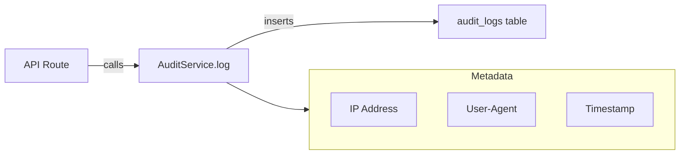

# Audit

This folder contains integration tests for the audit trail system, including the AuditService and API-level audit logging.

## Overview

The audit system provides an **immutable log** of all critical actions for:
- Legal compliance (electronic signatures)
- Dispute resolution
- Security monitoring
- Debugging

## Architecture



## Tests

### `audit-service.test.ts`
Direct AuditService testing:

| Test | Description |
|------|-------------|
| Record audit log with correct metadata | Verify IP, UA, timestamp captured |
| Handle anonymous actions (null userId) | System actions without user context |

### `audit-api.test.ts`
API-level audit logging:

| Test | Description |
|------|-------------|
| Audit auth events (register, login) | Auth routes create audit logs |
| Audit vehicle creation | Vehicle creation logged |
| Audit booking creation | Booking creation logged |

## Audit Log Schema

| Field | Type | Description |
|-------|------|-------------|
| `id` | serial | Primary key |
| `userId` | integer | Actor (null for system) |
| `action` | text | Action identifier |
| `entityType` | text | Entity type (booking, vehicle, etc.) |
| `entityId` | integer | Entity ID |
| `details` | jsonb | Action-specific data |
| `metadata` | jsonb | IP, UA, timestamp |
| `createdAt` | timestamp | When logged |

## Action Naming Convention

Format: `{entity}.{action}` or `{entity}.{action}.{subaction}`

| Action | Description |
|--------|-------------|
| `auth.register` | User registration |
| `auth.login` | User login |
| `vehicle.create` | Vehicle published |
| `booking.create` | Booking created |
| `booking.payment_proof_uploaded` | Payment proof added |
| `booking.dispute_filed` | Dispute raised |
| `contract.signed.stage1` | Publisher signed |
| `contract.signed.stage2` | Renter signed |

## Metadata Captured

```typescript
{
  ip: "192.168.1.100",
  userAgent: "Mozilla/5.0 (iPhone; CPU iPhone OS 16_0)",
  timestamp: "2026-02-02T14:30:00.000Z"
}
```

## AuditService API

```typescript
await AuditService.log(
  userId: number | null,    // Actor
  action: string,           // e.g., 'booking.create'
  entityType: string,       // e.g., 'booking'
  entityId: number,         // e.g., 123
  details: object,          // { totalPrice: 15000 }
  req?: Request             // For IP/UA extraction
);
```

## Related Documentation

- [AUDIT_COMPLIANCE.md](/docs/AUDIT_COMPLIANCE.md) - Compliance requirements
- [LEGAL_DISPUTE_AUDIT_TRAIL.md](/docs/LEGAL_DISPUTE_AUDIT_TRAIL.md) - Legal evidence

## Running Tests

```bash
cd apps/server
pnpm test tests/integration/audit
```
