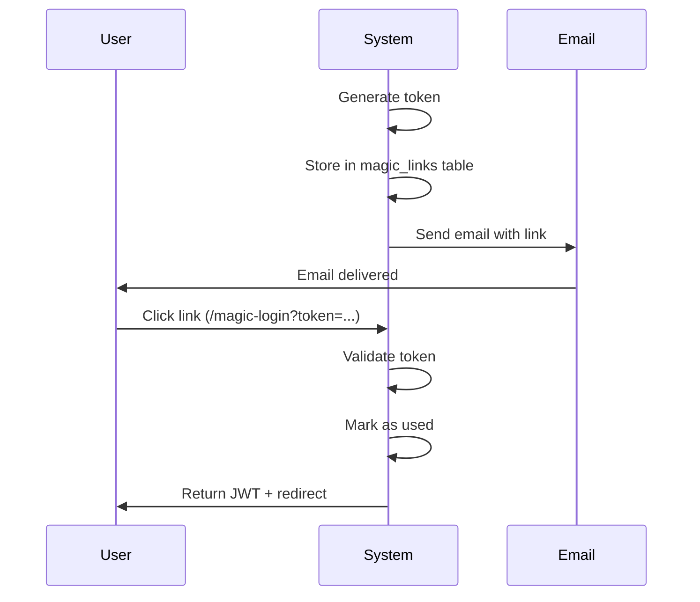

# Authentication

This folder contains integration tests for authentication mechanisms, including magic link login.

## Overview

Laburauto uses multiple authentication methods:

1. **Email/Password**: Traditional registration and login
2. **Magic Links**: Passwordless authentication via email (used for contract signing)

## Magic Links Flow



## Tests

### `magic-links.test.ts`
Magic link generation and consumption:

| Test | Description |
|------|-------------|
| Generate and consume magic link | Full happy path |
| Fail for expired tokens | Expiry enforcement |
| Fail for already used tokens | Single-use enforcement |

## Magic Link Schema

| Field | Type | Description |
|-------|------|-------------|
| `id` | serial | Primary key |
| `userId` | integer | User this link is for |
| `token` | text | Unique token (UUID) |
| `expiresAt` | timestamp | Expiry time (15 min default) |
| `usedAt` | timestamp | When consumed (null if unused) |
| `redirectPath` | text | Where to redirect after login |
| `createdAt` | timestamp | When created |

## Security Measures

| Measure | Implementation |
|---------|---------------|
| **Short expiry** | 15 minutes default |
| **Single use** | Marked used on consumption |
| **Cryptographic token** | UUID v4 |
| **Audit logged** | Creation and consumption logged |

## API Endpoints Tested

| Endpoint | Method | Purpose |
|----------|--------|---------|
| `/api/auth/register` | POST | Email/password registration |
| `/api/auth/login` | POST | Email/password login |
| `/api/auth/magic-login` | POST | Consume magic link |

## MagicLinkService API

```typescript
// Create link
const url = await MagicLinkService.createLink(
  userId: number,
  redirectPath: string,
  expiresInMinutes?: number // default: 15
);

// Verify and consume
const { user, redirectPath } = await MagicLinkService.verifyAndConsume(
  token: string
);
```

## Audit Trail

| Action | Logged Data |
|--------|-------------|
| `auth.magic_link_generated` | userId, redirectPath |
| `auth.magic_link_consumed` | userId, IP, User-Agent |

## Error Handling

| Error | Response |
|-------|----------|
| Token not found | `400 Invalid, expired, or already used magic link` |
| Token expired | `400 Invalid, expired, or already used magic link` |
| Token already used | `400 Invalid, expired, or already used magic link` |

## Running Tests

```bash
cd apps/server
pnpm test tests/integration/auth
```
