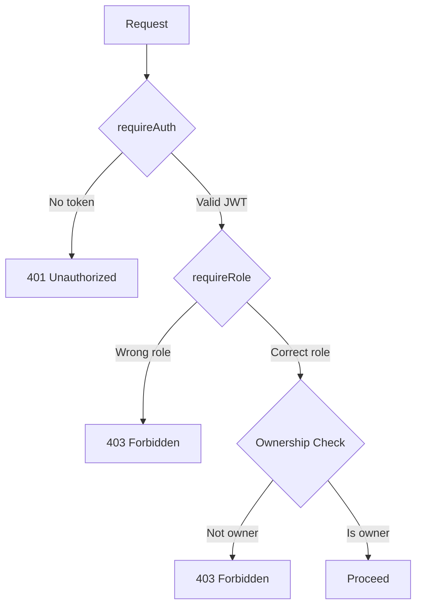

# Authentication & Authorization

This folder contains integration tests for the authentication and authorization system.

## Overview

The backend uses a **3-layer authorization model**:



## Middleware

| Middleware | Purpose |
|------------|---------|
| `requireAuth` | Verifies JWT, attaches `req.user` |
| `requireRole(...roles)` | Checks user role against allowed list |
| `requireOwnership(fn)` | Verifies resource ownership |
| `optionalAuth` | Attaches user if token present, but doesn't require it |

## Protected Routes

| Route | Protection |
|-------|------------|
| `GET /api/bookings` | `requireAuth` - scoped by role |
| `POST /api/vehicles` | `requireAuth + requireRole('publisher')` |
| `PUT /api/vehicles/:id/approve` | `requireAuth + requireRole('admin')` |
| `GET /api/admin/*` | `requireAuth + requireRole('admin')` |
| `POST /api/applications` | `requireAuth` - uses `req.user.id` |

## Tests

| Test | Description |
|------|-------------|
| Reject without token | 401 for protected routes |
| Reject invalid token | 401 for expired/malformed JWT |
| Reject role mismatch | 403 when driver accesses publisher route |
| Reject ownership mismatch | 403 when accessing another's resource |
| Allow valid request | 200 for authorized access |

## Running Tests

```bash
cd apps/server
pnpm vitest run tests/integration/auth/
```

## Related Files

- [auth.ts middleware](file:///Users/cesarrom/code/laburauto/apps/server/src/middleware/auth.ts)
- [admin routes](file:///Users/cesarrom/code/laburauto/apps/server/src/routes/admin.ts)
- [vehicle routes](file:///Users/cesarrom/code/laburauto/apps/server/src/routes/vehicles.ts)
