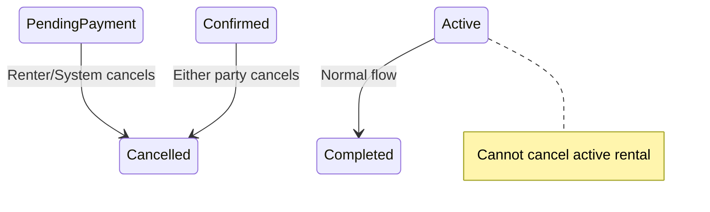

# Bookings

This folder contains integration tests for booking management, including location sharing and cancellation policies.

## Overview

Bookings are the core entity linking renters to vehicles for specific time periods. Key features tested:

1. **Location Sharing**: Vehicle location revealed only after payment confirmed
2. **Cancellation Policies**: Rules vary by booking state and initiator

## Tests

### `location-and-cancellation.test.ts`
Location sharing and cancellation rules:

| Test | Description |
|------|-------------|
| Allow location access when confirmed | Location shared after payment |
| NOT share location for pending_payment | Location blocked before payment |
| Publisher cancel confirmed with refund | Refund triggered on publisher cancel |
| NOT allow cancellation of active rental | Active rentals cannot be cancelled |
| Cancel before payment without refund | No refund when payment not made |

## Location Sharing

Location data is revealed conditionally:

| Field | Description |
|-------|-------------|
| `vehicles.idleLat` | Vehicle latitude |
| `vehicles.idleLong` | Vehicle longitude |
| `vehicles.idleAddress` | Human-readable address |
| `vehicles.accessInstructions` | Pickup instructions |

**Access Control:**
```typescript
// Only share if booking is confirmed+
if (['confirmed', 'active', 'completed'].includes(booking.status)) {
  return vehicle.location;
}
```

## Cancellation Matrix

| Initiator | Booking State | Allowed | Refund |
|-----------|--------------|---------|--------|
| Renter | `pending_payment` | ✅ | ❌ (no payment) |
| Renter | `confirmed` | ✅ | Partial |
| Publisher | `confirmed` | ✅ | Full |
| Publisher | `active` | ❌ | N/A |
| System | `pending_payment` | ✅ | ❌ (expired) |

## Cancellation Fields

| Field | Type | Description |
|-------|------|-------------|
| `cancelledBy` | enum | 'renter' / 'publisher' / 'system' |
| `cancelledAt` | timestamp | When cancelled |
| `cancellationReason` | text | Free-text reason |
| `refundStatus` | enum | 'none' / 'pending' / 'complete' |

## State Transitions



## Related Documentation

- [CANCELLATION_POLICY.md](/docs/CANCELLATION_POLICY.md) - Detailed policy rules
- [RENTAL_LIFECYCLE.md](/docs/RENTAL_LIFECYCLE.md) - Full booking lifecycle

## Running Tests

```bash
cd apps/server
pnpm test tests/integration/bookings
```
