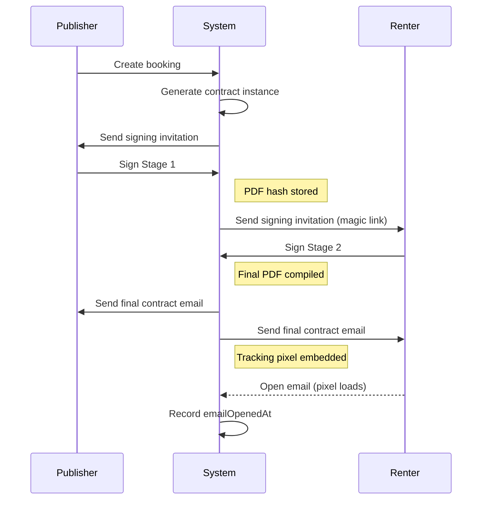

# Contracts

This folder contains integration tests for the contract system, including template creation, multi-stage signing, and email delivery with tracking.

## Overview

The contract system enables legally binding rental agreements with:
- **Templates**: Reusable PDF templates with variable placeholders
- **Instances**: Per-booking contracts with resolved variables
- **Multi-stage Signing**: Publisher signs first, then renter
- **Email Delivery**: Final PDF sent with tracking pixel



## Tests

### `contracts.test.ts`
Template and instance creation:

| Test | Description |
|------|-------------|
| Create template and use for rental agreement | Full template → instance → signing flow |

**Key Assertions:**
- Template created with fields and stages
- Variables resolved from booking context
- Instance linked to booking
- Multi-stage signing updates instance status

### `email-tracking.test.ts`
Email delivery and open tracking:

| Test | Description |
|------|-------------|
| Trigger email and track opening | Sign → Email sent → Tracking pixel → DB updated |

**Key Assertions:**
- Email contains tracking pixel URL
- Pixel endpoint returns 1x1 GIF
- `emailSentAt` and `emailOpenedAt` recorded
- PDF compiled and uploaded to storage

## API Endpoints Tested

| Endpoint | Method | Purpose |
|----------|--------|---------|
| `/api/contracts/templates` | POST | Create template |
| `/api/contracts/instances` | POST | Create instance |
| `/api/contracts/instances/:id/sign-stage-1` | POST | Publisher signs |
| `/api/contracts/instances/:id/sign-stage-2` | POST | Renter signs |
| `/api/contracts/instances/:id/track/:role` | GET | Tracking pixel |

## Variable Resolution

Templates support dynamic variables resolved from:

| Source | Example Variables |
|--------|------------------|
| `users` | `{{users.name}}`, `{{users.email}}` |
| `vehicles` | `{{vehicles.plate}}`, `{{vehicles.year}}` |
| `bookings` | `{{bookings.startDate}}`, `{{bookings.totalPrice}}` |

## Signing Stages

| Stage | Actor | Actions |
|-------|-------|---------|
| Stage 1 | Publisher | Reviews terms, adds signature |
| Stage 2 | Renter | Clicks magic link, signs, triggers email |

## Related Documentation

- [CONTRACT_SYSTEM.md](/docs/CONTRACT_SYSTEM.md) - Contract architecture
- [LEGAL_DISPUTE_AUDIT_TRAIL.md](/docs/LEGAL_DISPUTE_AUDIT_TRAIL.md) - Signing audit trail

## Running Tests

```bash
cd apps/server
pnpm test tests/integration/contracts
```
