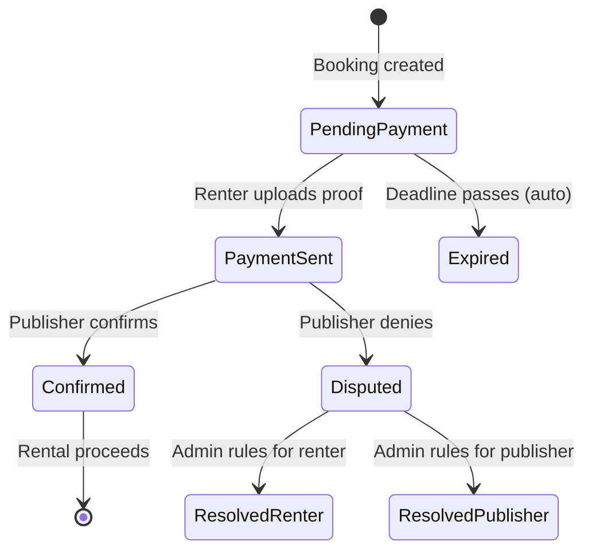

# Payments

This folder contains integration tests for the payment flow, including proof upload, confirmation, disputes, and auto-expiration.

## Overview

Laburauto uses an **off-platform payment** model where renters pay publishers directly (bank transfer, Mercado Pago, etc.). The platform facilitates proof verification and dispute resolution.



## Tests

### `payment-flow.test.ts`
Complete payment lifecycle:

| Test | Description |
|------|-------------|
| Legitimate payment flow with proof | Upload → Confirm flow |
| Flag dispute when publisher denies | Dispute filing mechanism |
| Auto-expire bookings past deadline | System auto-expiration |
| Not expire bookings with valid deadline | Deadline boundary check |

## Payment States

| State | Description |
|-------|-------------|
| `pending_payment` | Awaiting renter payment |
| `payment_sent` | Proof uploaded, awaiting confirmation |
| `confirmed` | Payment verified, rental can proceed |
| `disputed` | Publisher denies, admin review needed |
| `expired` | Payment deadline passed |

## Proof Hashing

When proof is uploaded, the system:
1. Fetches the image from URL
2. Calculates SHA-256 hash
3. Stores hash in `bookings.paymentProofHash`

This ensures **tamper detection** for legal disputes.

## Auto-Expiration

Bookings with `status: 'pending_payment'` are auto-expired when:
```sql
payment_deadline < NOW()
```

The cron job sets:
- `status: 'expired'`
- `cancelledBy: 'system'`
- `cancelledAt: NOW()`

## API Endpoints Tested

| Endpoint | Method | Purpose |
|----------|--------|---------|
| `/api/bookings/:id/payment/proof` | POST | Upload payment proof |
| `/api/bookings/:id/payment/confirm` | PUT | Publisher confirms |
| `/api/bookings/:id/payment/dispute` | POST | File dispute |

## Audit Trail

All payment actions are logged:

| Action | Logged Data |
|--------|-------------|
| `booking.payment_proof_uploaded` | proofUrl, proofHash |
| `booking.payment_confirmed` | confirmerId |
| `booking.dispute_filed` | filedBy, disputeNotes, proofHash |

## Related Documentation

- [PAYMENT_FRAUD_PREVENTION.md](/docs/PAYMENT_FRAUD_PREVENTION.md) - Fraud prevention measures
- [LEGAL_DISPUTE_AUDIT_TRAIL.md](/docs/LEGAL_DISPUTE_AUDIT_TRAIL.md) - Evidence for disputes

## Running Tests

```bash
cd apps/server
pnpm test tests/integration/payments
```
