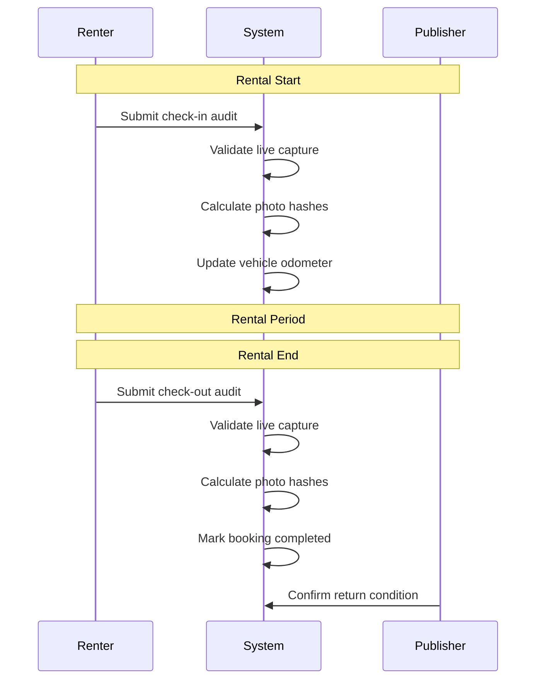

# Photo Audits

This folder contains integration tests for the photo audit system, including check-in/check-out flows and asset protection.

## Overview

Photo audits provide **visual evidence** of vehicle condition at rental boundaries:

1. **Check-in**: Renter photographs vehicle before taking possession
2. **Check-out**: Renter photographs vehicle upon return

This protects both parties in damage disputes.



## Tests

### `advanced-features.test.ts`
Photo audit functionality:

| Test | Description |
|------|-------------|
| Reject audit with non-live metadata | Block gallery photos |
| Submit check-in and update odometer | Happy path check-in |
| Complete booking on check-out | State transition |
| Generate evidence kit | Admin evidence retrieval |

## Photo Audit Schema

| Field | Type | Description |
|-------|------|-------------|
| `id` | serial | Primary key |
| `bookingId` | integer | Associated booking |
| `type` | enum | 'check_in' / 'check_out' |
| `photos` | jsonb | Array of photo URLs |
| `photoHashes` | jsonb | SHA-256 hash per photo |
| `odometerReading` | integer | Odometer at time of audit |
| `metadata` | jsonb | GPS, device info, isLive flag |
| `createdAt` | timestamp | When submitted |

## Live Photo Validation

The system rejects photos from the gallery:

```typescript
if (!metadata.isLive) {
  return res.status(403).json({ 
    error: 'Photos must be taken live, not selected from gallery' 
  });
}
```

**Why?** Gallery photos could be old, manipulated, or belong to different vehicles.

## Photo Hashing

Each photo URL is fetched and hashed:

```typescript
for (const photoUrl of photos) {
  const response = await fetch(photoUrl);
  const buffer = await response.arrayBuffer();
  const hash = crypto.createHash('sha256')
    .update(Buffer.from(buffer))
    .digest('hex');
  photoHashes.push(hash);
}
```

**Purpose**: Proves photos haven't been altered after submission.

## Odometer Tracking

| Event | Update |
|-------|--------|
| Check-in | `vehicles.lastOdometer = odometerReading` |
| Check-out | Compared against check-in for mileage calculation |

## API Endpoints Tested

| Endpoint | Method | Purpose |
|----------|--------|---------|
| `/api/audits` | POST | Submit check-in/check-out audit |
| `/api/admin/evidence-kit/:bookingId` | GET | Retrieve all evidence |

## Request Payload

```json
{
  "bookingId": 123,
  "type": "check_in",
  "photos": [
    "https://storage.example.com/photo1.jpg",
    "https://storage.example.com/photo2.jpg"
  ],
  "odometerReading": 45230,
  "metadata": {
    "isLive": true,
    "gps": { "lat": -34.6037, "lng": -58.3816 },
    "deviceId": "iPhone 14 Pro",
    "capturedAt": "2026-02-02T10:00:00Z"
  }
}
```

## Evidence Kit Response

```json
{
  "legalIdentity": {
    "renterName": "Alice",
    "renterEmail": "alice@example.com"
  },
  "contract": {
    "status": "signed",
    "pdfUrl": "..."
  },
  "auditHistory": [
    {
      "type": "check_in",
      "photos": ["url1", "url2"],
      "photoHashes": ["hash1", "hash2"],
      "odometerReading": 45230
    },
    {
      "type": "check_out",
      "photos": ["url3"],
      "odometerReading": 45500
    }
  ]
}
```

## Related Documentation

- [LEGAL_DISPUTE_AUDIT_TRAIL.md](/docs/LEGAL_DISPUTE_AUDIT_TRAIL.md) - Evidence for damage claims

## Running Tests

```bash
cd apps/server
pnpm test tests/integration/photo-audits
```
