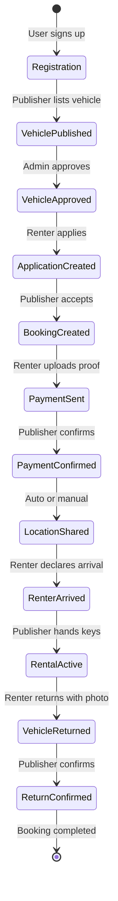

# Rental Lifecycle

This folder contains integration tests for the complete rental lifecycle, from user registration through vehicle return and confirmation.

## Overview

The rental lifecycle covers the end-to-end flow of a vehicle rental on Laburauto:



## Tests

### `happy-path.test.ts`
Single comprehensive test that walks through every state transition:

| Phase | Description |
|-------|-------------|
| 1. User Registration | Create publisher, renter, admin |
| 2. Vehicle Creation | Publisher adds vehicle to platform |
| 3. Admin Approval | Admin reviews and approves vehicle |
| 4. Renter Documents | Renter uploads verification documents |
| 5. Shift Creation | Publisher defines availability |
| 6. Application | Renter applies for rental slot |
| 7. Booking | Publisher accepts, creates booking |
| 8. Payment Proof | Renter uploads payment proof |
| 9. Payment Confirmation | Publisher confirms receipt |
| 10. Location Sharing | Location revealed to renter |
| 11. Arrival | Renter marks arrival |
| 12. Rental Start | Publisher activates rental |
| 13. Return | Renter returns with photo |
| 14. Return Confirmed | Publisher confirms condition |

### `comprehensive-flow.test.ts`
API-level integration using supertest against the actual Express app:

| Test | Description |
|------|-------------|
| Full Happy Path with Signing | Complete flow including contract signing |
| Dispute: Wrong Amount Sent | Payment dispute handling |
| Cancellation: Fuerza Mayor | Force majeure cancellation |

## API Endpoints Tested

| Endpoint | Method | Purpose |
|----------|--------|---------|
| `/api/auth/register` | POST | User registration |
| `/api/vehicles` | POST | Vehicle creation |
| `/api/vehicles/:id/approve` | PUT | Admin approval |
| `/api/applications` | POST | Rental application |
| `/api/bookings` | POST | Booking creation |
| `/api/bookings/:id/payment/proof` | POST | Payment proof upload |
| `/api/bookings/:id/payment/confirm` | PUT | Payment confirmation |
| `/api/contracts/instances/:id/sign-stage-1` | POST | Publisher signing |
| `/api/contracts/instances/:id/sign-stage-2` | POST | Renter signing |

## Related Documentation

- [RENTAL_LIFECYCLE.md](/docs/RENTAL_LIFECYCLE.md) - Detailed state machine
- [CANCELLATION_POLICY.md](/docs/CANCELLATION_POLICY.md) - Cancellation rules

## Running Tests

```bash
cd apps/server
pnpm test tests/integration/rental-lifecycle
```
